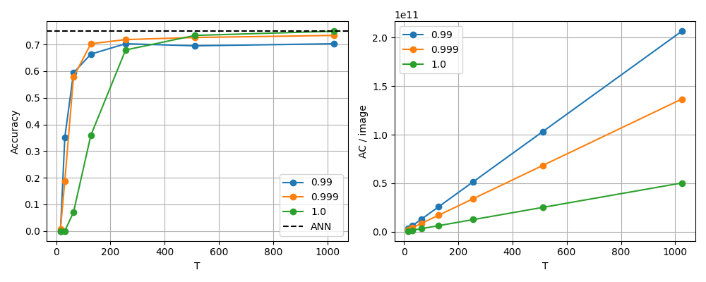
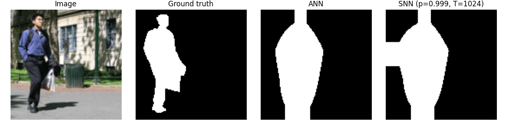

# Лабораторная работа 1

BatchNorm объединён со свёртками в eval-режиме. Пороги выбраны по положительным
ANN-активациям. ReLU заменены IF-нейронами с мягким сбросом; частотный MaxPool
пропускает импульсы победителя. Residual-ветви складываются перед выходным IF.
Выходные признаки усредняются по времени. Декодер сегментации остаётся аналоговым
и одинаков для ANN и SNN.

Калибровка: 128 изображений; классификация:
128 отдельных изображений. Сегментация:
64 обучающих и
16 тестовых изображений. Seed=42.
Максимальная ошибка folding на проверочном изображении: 1.306e-06.

Точность ANN: **75.00%**.
Лучший результат SNN: **75.00%** при p=1, T=1024.
Потеря: **0.000 п.п.**

Минимальное подходящее T=512, p=1.

Для этого режима IoU ANN/SNN: **0.311 / 0.318**,
Dice ANN/SNN: **0.446 / 0.458**.

MAC/AC — модель операций, а не измерение энергии GPU. Один спайк может вызвать
много AC. Не учитываются доступ к памяти, сравнения, bias, обновления потенциалов,
pooling и усреднение. Рост T уменьшает квантование и переходные ошибки, но не
устраняет насыщение. Малые выборки FAST_MODE дают предварительные оценки.

Полные результаты: [сводная таблица](summary.csv), [спайки по слоям](layer_spikes.csv),
[минимальное T](minimum_T.csv), [проверка folding](folding_check.csv).
<table border="1" class="dataframe">
  <thead>
    <tr style="text-align: right;">
      <th>p</th>
      <th>T</th>
      <th>accuracy</th>
      <th>MAC_per_image</th>
      <th>total_AC_per_image</th>
      <th>spikes_per_image</th>
      <th>spikes_per_neuron</th>
    </tr>
  </thead>
  <tbody>
    <tr>
      <td>0.990</td>
      <td>16</td>
      <td>0.0000</td>
      <td>118525952.0</td>
      <td>3.064275e+09</td>
      <td>6.051713e+06</td>
      <td>2.6220</td>
    </tr>
    <tr>
      <td>0.990</td>
      <td>32</td>
      <td>0.3516</td>
      <td>118525952.0</td>
      <td>6.270918e+09</td>
      <td>1.238901e+07</td>
      <td>5.3676</td>
    </tr>
    <tr>
      <td>0.990</td>
      <td>64</td>
      <td>0.5938</td>
      <td>118525952.0</td>
      <td>1.272167e+10</td>
      <td>2.509483e+07</td>
      <td>10.8725</td>
    </tr>
    <tr>
      <td>0.990</td>
      <td>128</td>
      <td>0.6641</td>
      <td>118525952.0</td>
      <td>2.564494e+10</td>
      <td>5.052539e+07</td>
      <td>21.8905</td>
    </tr>
    <tr>
      <td>0.990</td>
      <td>256</td>
      <td>0.7031</td>
      <td>118525952.0</td>
      <td>5.150100e+10</td>
      <td>1.013980e+08</td>
      <td>43.9314</td>
    </tr>
    <tr>
      <td>0.990</td>
      <td>512</td>
      <td>0.6953</td>
      <td>118525952.0</td>
      <td>1.032182e+11</td>
      <td>2.031482e+08</td>
      <td>88.0155</td>
    </tr>
    <tr>
      <td>0.990</td>
      <td>1024</td>
      <td>0.7031</td>
      <td>118525952.0</td>
      <td>2.066539e+11</td>
      <td>4.066520e+08</td>
      <td>176.1850</td>
    </tr>
    <tr>
      <td>0.999</td>
      <td>16</td>
      <td>0.0078</td>
      <td>118525952.0</td>
      <td>2.025630e+09</td>
      <td>3.894993e+06</td>
      <td>1.6875</td>
    </tr>
    <tr>
      <td>0.999</td>
      <td>32</td>
      <td>0.1875</td>
      <td>118525952.0</td>
      <td>4.134506e+09</td>
      <td>8.009889e+06</td>
      <td>3.4703</td>
    </tr>
    <tr>
      <td>0.999</td>
      <td>64</td>
      <td>0.5781</td>
      <td>118525952.0</td>
      <td>8.392920e+09</td>
      <td>1.627739e+07</td>
      <td>7.0523</td>
    </tr>
    <tr>
      <td>0.999</td>
      <td>128</td>
      <td>0.7031</td>
      <td>118525952.0</td>
      <td>1.693927e+10</td>
      <td>3.283756e+07</td>
      <td>14.2271</td>
    </tr>
    <tr>
      <td>0.999</td>
      <td>256</td>
      <td>0.7188</td>
      <td>118525952.0</td>
      <td>3.404633e+10</td>
      <td>6.597143e+07</td>
      <td>28.5826</td>
    </tr>
    <tr>
      <td>0.999</td>
      <td>512</td>
      <td>0.7266</td>
      <td>118525952.0</td>
      <td>6.826823e+10</td>
      <td>1.322475e+08</td>
      <td>57.2972</td>
    </tr>
    <tr>
      <td>0.999</td>
      <td>1024</td>
      <td>0.7344</td>
      <td>118525952.0</td>
      <td>1.367146e+11</td>
      <td>2.648024e+08</td>
      <td>114.7276</td>
    </tr>
    <tr>
      <td>1.000</td>
      <td>16</td>
      <td>0.0000</td>
      <td>118525952.0</td>
      <td>7.440823e+08</td>
      <td>1.244225e+06</td>
      <td>0.5391</td>
    </tr>
    <tr>
      <td>1.000</td>
      <td>32</td>
      <td>0.0000</td>
      <td>118525952.0</td>
      <td>1.511153e+09</td>
      <td>2.703480e+06</td>
      <td>1.1713</td>
    </tr>
    <tr>
      <td>1.000</td>
      <td>64</td>
      <td>0.0703</td>
      <td>118525952.0</td>
      <td>3.051701e+09</td>
      <td>5.621647e+06</td>
      <td>2.4356</td>
    </tr>
    <tr>
      <td>1.000</td>
      <td>128</td>
      <td>0.3594</td>
      <td>118525952.0</td>
      <td>6.172489e+09</td>
      <td>1.149744e+07</td>
      <td>4.9814</td>
    </tr>
    <tr>
      <td>1.000</td>
      <td>256</td>
      <td>0.6797</td>
      <td>118525952.0</td>
      <td>1.244958e+10</td>
      <td>2.328510e+07</td>
      <td>10.0884</td>
    </tr>
    <tr>
      <td>1.000</td>
      <td>512</td>
      <td>0.7344</td>
      <td>118525952.0</td>
      <td>2.502201e+10</td>
      <td>4.688124e+07</td>
      <td>20.3117</td>
    </tr>
    <tr>
      <td>1.000</td>
      <td>1024</td>
      <td>0.7500</td>
      <td>118525952.0</td>
      <td>5.017350e+10</td>
      <td>9.408218e+07</td>
      <td>40.7618</td>
    </tr>
  </tbody>
</table><table border="1" class="dataframe">
  <thead>
    <tr style="text-align: right;">
      <th>p</th>
      <th>T</th>
      <th>ANN_IoU</th>
      <th>ANN_Dice</th>
      <th>SNN_IoU</th>
      <th>SNN_Dice</th>
    </tr>
  </thead>
  <tbody>
    <tr>
      <td>0.990</td>
      <td>16</td>
      <td>0.311</td>
      <td>0.4463</td>
      <td>0.1869</td>
      <td>0.2785</td>
    </tr>
    <tr>
      <td>0.990</td>
      <td>32</td>
      <td>0.311</td>
      <td>0.4463</td>
      <td>0.3055</td>
      <td>0.4376</td>
    </tr>
    <tr>
      <td>0.990</td>
      <td>64</td>
      <td>0.311</td>
      <td>0.4463</td>
      <td>0.3117</td>
      <td>0.4566</td>
    </tr>
    <tr>
      <td>0.990</td>
      <td>128</td>
      <td>0.311</td>
      <td>0.4463</td>
      <td>0.2920</td>
      <td>0.4298</td>
    </tr>
    <tr>
      <td>0.990</td>
      <td>256</td>
      <td>0.311</td>
      <td>0.4463</td>
      <td>0.2896</td>
      <td>0.4246</td>
    </tr>
    <tr>
      <td>0.990</td>
      <td>512</td>
      <td>0.311</td>
      <td>0.4463</td>
      <td>0.2889</td>
      <td>0.4220</td>
    </tr>
    <tr>
      <td>0.990</td>
      <td>1024</td>
      <td>0.311</td>
      <td>0.4463</td>
      <td>0.2887</td>
      <td>0.4203</td>
    </tr>
    <tr>
      <td>0.999</td>
      <td>16</td>
      <td>0.311</td>
      <td>0.4463</td>
      <td>0.1376</td>
      <td>0.2034</td>
    </tr>
    <tr>
      <td>0.999</td>
      <td>32</td>
      <td>0.311</td>
      <td>0.4463</td>
      <td>0.3322</td>
      <td>0.4794</td>
    </tr>
    <tr>
      <td>0.999</td>
      <td>64</td>
      <td>0.311</td>
      <td>0.4463</td>
      <td>0.3506</td>
      <td>0.5032</td>
    </tr>
    <tr>
      <td>0.999</td>
      <td>128</td>
      <td>0.311</td>
      <td>0.4463</td>
      <td>0.3243</td>
      <td>0.4709</td>
    </tr>
    <tr>
      <td>0.999</td>
      <td>256</td>
      <td>0.311</td>
      <td>0.4463</td>
      <td>0.3101</td>
      <td>0.4513</td>
    </tr>
    <tr>
      <td>0.999</td>
      <td>512</td>
      <td>0.311</td>
      <td>0.4463</td>
      <td>0.3037</td>
      <td>0.4418</td>
    </tr>
    <tr>
      <td>0.999</td>
      <td>1024</td>
      <td>0.311</td>
      <td>0.4463</td>
      <td>0.3013</td>
      <td>0.4377</td>
    </tr>
    <tr>
      <td>1.000</td>
      <td>16</td>
      <td>0.311</td>
      <td>0.4463</td>
      <td>0.1715</td>
      <td>0.2755</td>
    </tr>
    <tr>
      <td>1.000</td>
      <td>32</td>
      <td>0.311</td>
      <td>0.4463</td>
      <td>0.1801</td>
      <td>0.2869</td>
    </tr>
    <tr>
      <td>1.000</td>
      <td>64</td>
      <td>0.311</td>
      <td>0.4463</td>
      <td>0.2938</td>
      <td>0.4337</td>
    </tr>
    <tr>
      <td>1.000</td>
      <td>128</td>
      <td>0.311</td>
      <td>0.4463</td>
      <td>0.3404</td>
      <td>0.4926</td>
    </tr>
    <tr>
      <td>1.000</td>
      <td>256</td>
      <td>0.311</td>
      <td>0.4463</td>
      <td>0.3355</td>
      <td>0.4841</td>
    </tr>
    <tr>
      <td>1.000</td>
      <td>512</td>
      <td>0.311</td>
      <td>0.4463</td>
      <td>0.3251</td>
      <td>0.4681</td>
    </tr>
    <tr>
      <td>1.000</td>
      <td>1024</td>
      <td>0.311</td>
      <td>0.4463</td>
      <td>0.3182</td>
      <td>0.4577</td>
    </tr>
  </tbody>
</table>